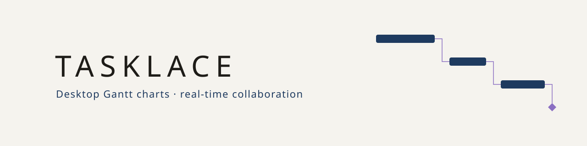

# Tasklace

<picture>
  <source media="(prefers-color-scheme: dark)" srcset=".github/assets/banner-dark.svg">
  
</picture>

[](https://github.com/GFayrr/tasklace/actions/workflows/ci.yml)
[](LICENSE)
[](#roadmap)
[](https://nodejs.org/)

A simple desktop application to create, edit, share and export Gantt charts, faithful to the rules of the Gantt method.

> [!IMPORTANT]
> Tasklace is not released yet. The application is complete for its first version: planning, project settings, PDF export, and real-time collaboration on a local network or through an end-to-end encrypted relay. What remains is distribution, a signed Windows executable that runs with a double-click. Until then, Tasklace can only be run from the source code.

Tasklace is designed for students and professionals who want clear project plans without a steep learning curve. Every action should be obvious to a non-technical user: advanced features exist, but none is imposed.

## Table of Contents

- [Background](#background)
- [Features](#features)
- [Install](#install)
- [Usage](#usage)
- [Roadmap](#roadmap)
- [Security](#security)
- [Development](#development)
- [Maintainers](#maintainers)
- [Acknowledgements](#acknowledgements)
- [Contributing](#contributing)
- [License](#license)

## Background

Most Gantt tools are either heavyweight project-management suites or online services that keep your data on their servers. Tasklace aims for the middle ground:

- **Strict Gantt rules**: tasks, milestones, summary tasks, the four dependency types, working calendars, progress and critical path.
- **Quarter-hour precision**: durations in hours and minutes, by quarter hours, spread over working days.
- **Collaboration without an account**: people join a plan with a code on the local network, or with a link through an end-to-end encrypted relay that any school or company can host.
- **Offline first**: every member keeps a copy of the plan on their computer, and changes are merged when they reconnect.
- **Lightweight exports**: vector PDF files with selectable text.

## Features

### Planning

- Dates worked out from the project start, task start dates, durations and dependencies.
- Finish-to-start, start-to-start, finish-to-finish and start-to-finish dependencies, with lags and leads in working hours; dependency cycles are refused.
- Milestones, nested summary tasks with duration-weighted progress, and WBS numbering (1, 1.1, 1.2…).
- Split tasks: one task made of several blocks separated by interruptions, each block able to wait for another task or block.
- Working calendars: working weekdays, one or more daily time ranges and days off; no public holiday is assumed.
- Hours per day and an optional daily start time for each task.

### Working with the plan

- A task table and a timeline side by side: edit names, durations, dates, progress, predecessors and tags in the table; drag and stretch bars, and link tasks or blocks by dragging on the timeline.
- Zoom by hour, day, week or month, with non-working time shaded and a line for today.
- Undo and redo that never touch the changes of others, and keyboard shortcuts for every common action.
- Project settings in one window: name and start, working days, working hours to the quarter hour and days off, each change applied at once and undone with Ctrl+Z.

### Tags and conflicts

- Optional tags that color the bars: a 12-color palette, any custom color, and automatic patterns when two colors could be confused, including for color-blind readers and grayscale prints.
- Tags that represent a person or a team: overlapping work is detected to the quarter hour and listed as grouped conflict periods, without moving anything.

### Advanced options

Off by default, each one turned on per project:

- **Critical path**: total and free floats in the table, critical tasks underlined on the timeline, and how far the others can slip.
- **Date constraints**: a date a task must finish on and a deadline, each missed date marked and listed with the conflicts.
- **Baseline**: freeze the plan, then see where each task was planned and how many working days later or earlier it now ends.

### Files and exports

- `.tasklace` project files: compressed, checksummed and fully checked before opening, so that a damaged or forged file is refused without ever being loaded.
- Automatic saving, a local copy of every project, and the last three projects at hand.
- CSV import and export for Excel or LibreOffice, with regional dates and separators, errors reported by row and column, and protection against formula injection.
- JSON import and export: compact documents with dates in clear text.
- PDF export: A4, A3 or US Letter, the whole project or chosen days, an automatic or chosen zoom, optional columns and a live preview. Text is never smaller than 10 points; a large plan is printed on a grid of pages that repeat the names and the time scale.

### Collaboration

- **On the local network**: share a plan and give the people near you its six-character code; they find it nearby or type the address of the host. Newcomers join in read only until the host lets them edit.
- **From anywhere, through a relay**: share a plan through the relay of your school or company and send one of its two links, to edit or to view. A plan joined this way stays on your computer and reopens from the recent projects.
- People in a shared plan see who is there and which task each one has selected.
- A shared plan keeps going on its own: a lost connection comes back without any action, on the local network someone else takes over when the host leaves, and changes made offline are shared on return, or kept in a copy of your own when you were in read only.

## Install

There is no release yet. Tasklace will ship as a portable Windows executable: download it and double-click to run, with nothing else to install. An installer will also be offered.

Until then, Tasklace can be run from the source code, which needs [Node.js](https://nodejs.org/) 24 LTS and npm:

```sh
git clone https://github.com/GFayrr/tasklace.git
cd tasklace
npm install
npm run dev
```

### Hosting a relay

A relay lets people share plans from anywhere. It is a small Node.js server that a school or a company runs on its own machine, with Docker and Caddy, behind Apache or nginx, or on its own with systemd. The guide [Working remotely: setting up a relay](docs/working-remotely.md) walks an IT department through every step.

## Usage

1. On the welcome screen, choose **New project**, **Open…** a Tasklace project, **Import…** a CSV or JSON file, or **Join…** a plan shared with you.
2. Add tasks in the table, then set their durations and predecessors; the dates are worked out at once and drawn on the timeline.
3. Open **Project settings** (the gear next to the project name, or Ctrl+,) to set the start, the working calendar, the tags and the advanced options.
4. Use **Export** for a CSV table, a JSON file or a PDF.
5. Use **Share** to work with others, on this network with a code, or through a relay with a link.

Projects are saved automatically.

## Roadmap

- [x] Working-time calendar
- [x] Scheduling engine: dependencies, summaries, split tasks, critical path
- [x] Tags and person or team conflict detection
- [x] Project file format, validation, JSON and CSV import and export
- [x] Desktop application and user interface
- [x] PDF export
- [x] Real-time collaboration on the local network
- [x] End-to-end encrypted relay and deployment guide
- [ ] Portable Windows executable

Windows comes first; the code stays cross-platform so that macOS and Linux versions can follow. The [roadmap](docs/roadmap.md) tells what comes next, what may come later and what is not planned.

## Security

Tasklace treats every file it opens and every message it receives as untrusted:

- Project files and network messages are size-limited and fully validated before use; files are decoded in an isolated worker with capped memory.
- The desktop shell runs with context isolation, a sandbox and a strict content security policy, and loads no remote content.
- On the local network, everything is encrypted after a key exchange based on the join code (CPace), and only computers on a private network are accepted.
- Through a relay, plans and presence are encrypted end to end (AES-256-GCM) and every change is signed (Ed25519); the relay stores and passes on messages it cannot read. Links are kept in the vault of the system.

To report a vulnerability, do not open a public issue: follow the [security policy](SECURITY.md).

## Development

### Commands

| Command                | Purpose                                                         |
| ---------------------- | --------------------------------------------------------------- |
| `npm run dev`          | Start the desktop application in development mode               |
| `npm run build`        | Build the main process, the preload bridge and the page         |
| `npm test`             | Run unit and property-based tests with coverage                 |
| `npm run test:watch`   | Run tests in watch mode                                         |
| `npm run test:e2e`     | Build, then test the running application end to end             |
| `npm run bench`        | Check performance on 10,000 tasks and 20,000 links              |
| `npm run bench:growth` | Check that key operations grow as their complexity says         |
| `npm run pdf:compare`  | Print three sample plans with both PDF engines and compare them |
| `npm run lint`         | Type-check TypeScript and Svelte, lint with ESLint              |
| `npm run format`       | Format the code with Prettier                                   |
| `npm run format:check` | Check formatting without changing files                         |

### Tests

The test suite covers edge cases extensively and uses property-based testing to check scheduling invariants, merges and data exchange on thousands of random projects, and to make sure that no malformed input is ever accepted. Every file keeps at least 90% coverage. Continuous integration runs formatting, linting, unit tests and end-to-end tests on Windows and Linux, the unit tests again in two time zones far from UTC, the growth checks of key operations, and builds and checks the relay image, for every push and pull request.

### Project structure

```
src/core/            pure logic, independent of any user interface
  baseline/          baseline plan snapshots
  calendar/          working-time calendar and task time slots
  collaboration/     shared plan protocol, people and rights, succession, join code, CPace and encrypted channel,
                     relay links, keys, encrypted envelopes and members
  exchange/          JSON and CSV import and export
  file/              .tasklace project file: header, checksum and defensive reading
  model/             project data types
  print/             printed page layout, drawing orders and their checks, SVG
  scheduling/        dependency graph, forward and backward passes, summaries, WBS
  shared/            shared Yjs document, merge repairs and fractional ordering
  tags/              tag colors, patterns and person or team conflicts
  testing/           test helpers and random data generators
  validation/        validation of untrusted project data
src/main/            Electron main process: window, security, files, file worker, PDF printing, host server, discovery,
                     relay connection and links kept in the system vault
src/preload/         minimal typed bridge between the page and the main process
src/renderer/        Svelte user interface: theme, messages, schedule worker, components, printed pages
relay/               relay server (Node.js and ws), its Dockerfile and Docker Compose file with Caddy
docs/                roadmap, and the guide to setting up a relay
tests/e2e/           end-to-end journeys in the running application (Playwright)
tests/file/          .tasklace files with real compression and generated decompression bombs
tests/fixtures/      large test projects and PDF sample plans generated from fixed seeds
tests/growth/        growth checks of key operations, run in CI
tests/perf/          performance benchmark
tests/pdf-compare/   comparison of the two PDF engines on the sample plans
tests/repository/    repository checks: small text fixtures, no text written in a component, comments, wording
```

## Maintainers

[@GFayrr](https://github.com/GFayrr)

## Acknowledgements

Tasklace is built on [Electron](https://www.electronjs.org/), [Svelte](https://svelte.dev/) and [Yjs](https://yjs.dev/), with cryptography from [noble](https://paulmillr.com/noble/), WebSockets from [ws](https://github.com/websockets/ws), PDF writing from [PDFKit](https://pdfkit.org/) and the [Jost](https://github.com/indestructible-type/Jost) typeface.

## Contributing

The project is at an early stage and is not accepting pull requests yet. Bug reports and suggestions are welcome in the [issue tracker](https://github.com/GFayrr/tasklace/issues).

## License

[AGPL-3.0-or-later](LICENSE) © Fayr

The Jost font is embedded under the [SIL Open Font License 1.1](src/renderer/public/fonts/OFL.txt).
